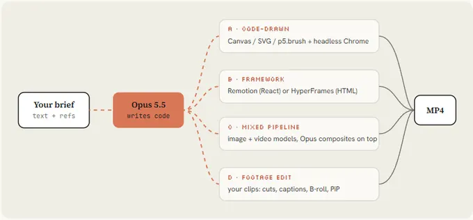

# As 4 rotas: do brief ao MP4



Em todas as rotas, o Opus 5.5 **escreve código**; ele não gera vídeo. O que muda é **o que transforma esse código em frames**.

| Rota | Melhor para | Força | Fraqueza |
|---|---|---|---|
| **A · Desenhado em código** | Showreels, motion de UI, loops, pixel art | Zero dependências, totalmente editável, é o padrão do Opus | Personagens e fotorrealismo exigem muita especificação |
| **B · Framework** | Explainers, vídeos de produto, séries | Preview em studio, componentes reutilizáveis, código guiado por skills | O Remotion exige licença de empresa acima de 3 pessoas |
| **C · Misto** | Clipes musicais, histórias com personagens | Física e rostos vindos de modelos de vídeo | Gasto com API, trabalho de sincronia, menos determinismo |
| **D · Footage** | Talking heads, reels, edições de lançamento | Seu rosto e sua voz reais ficam no vídeo | Exige footage bruto e áudio limpo |

---

## A · Desenhado em código (Canvas / SVG / p5.brush + Chrome headless)

**Engine pronta e testada em [../02-engine/](../02-engine/).**

```powershell
cd biblioteca\02-engine
node render.mjs --fps 60 --dur 15 --sub 4                  # 9:16 padrão
node render.mjs --w 1920 --h 1080 --out out\16x9.mp4      # mesma timeline em 16:9
node render.mjs --from 4 --dur 2 --out out\patch.mp4      # re-render só de um trecho
.\qa.ps1 -Video out\silent.mp4                              # contact sheet, strip, celular, loop
.\qa.ps1 -Determinism                                       # 2 renders, hashes iguais
```

Variantes de visual:
- **Pintado à mão / personagens:** [ClaudeAnimationBase](../refs/repos/ClaudeAnimationBase/) (p5.js + p5.brush, personagem Clawd com 31 emoções, `ANIMATION_GUIDE.md`; precisa de GPU) e [PDoomVideo](../refs/repos/PDoomVideo/) (o clipe completo, com subagentes por capítulo).
- **Ilustração densa sem browser:** [claude-animation-skill](../refs/repos/claude-animation-skill/) (Node canvas, sem GPU e sem chaves de API; "detail bible" com textura, hachura e aquarela). Instalação:
  `claude plugin marketplace add buildwithhanif/claude-animation-skill` e depois `claude plugin install claude-animation@claude-animation-skill`
- **WebGL / filme longo:** [Battle-of-Austerlitz-Film](../refs/repos/Battle-of-Austerlitz-Film/), um filme de 5:01 com cada frame renderizado em WebGL, som sintetizado e voz gerada.

## B · Framework (Remotion ou HyperFrames)

O Opus **não escolhe framework sozinho**; é preciso pedir pelo nome.

**Remotion (React):** bom para séries, templates e vídeos guiados por dados. Atenção à **licença** em equipes de mais de 3 pessoas.

```powershell
npx create-video@latest launch-film; cd launch-film
npx skills add remotion-dev/skills
claude
#  > /remotion-create a 20s 9:16 launch film for [PRODUCT], springs only, one accent color
npx remotion studio
npx remotion render Main out/launch.mp4
```

Skills disponíveis (em [refs/repos/skills/skills/](../refs/repos/skills/skills/)): `remotion-create`, `remotion-render`, `remotion-studio`, `remotion-best-practices`, `remotion-captions`, `remotion-saas`, `remotion-maps`, `remotion-multimedia`, entre outras.

**HyperFrames (HTML + GSAP):** bom quando você pensa em páginas web. Composições com `data-start` e `data-duration` e uma timeline GSAP pausada em `window.__timelines`.

```powershell
npx hyperframes init my-video; cd my-video
npx hyperframes skills update
claude
#  > Using /hyperframes, turn ./notes.md into a 45-second pitch video with kinetic captions
npx hyperframes preview; npx hyperframes render
```

Skills úteis (em [refs/repos/hyperframes/skills/](../refs/repos/hyperframes/skills/)): `product-launch-video` (URL para vídeo promocional), `music-to-video` (vídeo sincronizado ao beat), `motion-graphics`, `faceless-explainer`, `pr-to-video`, `slideshow` e `remotion-to-hyperframes`.

Exemplos: catálogo #13 (Steve Jobs, Remotion + SVG, ~8,7 mil linhas) e #14 ("small print", HyperFrames).

## C · Pipeline misto (modelos de imagem, vídeo e voz + composição pelo Opus)

- **Generate-then-trace:** o Seedance 2.5 (via `FAL_KEY`) gera os planos base com física e personagens, e o Opus redesenha tudo em JS por cima. Veja [../03-prompts/05-director-brief.md](../03-prompts/05-director-brief.md) e o brief completo do Donald (catálogo #16).
- **Voz e mascote:** ElevenLabs (`ELEVENLABS_API_KEY`). Anime no tempo da voz medida, não o contrário. Exemplos: catálogo #08 e #20 (@achxvi).
- As chaves vão em `.env` e o orçamento vai no brief ("Be economical").
- Perde-se determinismo: **congele** os assets gerados em arquivos locais antes de animar por cima.

## D · Edição de footage (seus clipes: cortes, legendas, B-roll, PiP)

> O curso só cita esta rota na tabela e não a detalha. O que segue é complemento nosso, a partir das skills que vieram nos repositórios clonados.

- **HyperFrames `talking-head-recut`:** aplica cards gráficos (títulos cinéticos, lower-thirds, callouts, citações, PiP) sincronizados à transcrição, com o clipe original intacto por baixo, em 16:9, 9:16 ou 4:5.
- **HyperFrames `embedded-captions`** e **`media-use`:** transcrição, legendas, voiceover, remoção de fundo, cortes e reenquadramento.
- **Remotion `remotion-captions`:** transcrição e legendas animadas.
- **ffmpeg puro**, para cortes simples:

  ```powershell
  ffmpeg -ss 00:00:12 -to 00:00:27 -i bruto.mp4 -c copy corte.mp4
  ```

Pré-requisito: áudio limpo. Os princípios das outras rotas continuam valendo: hits no beat, −14 LUFS, a crítica com contact sheet e o teste de celular.
